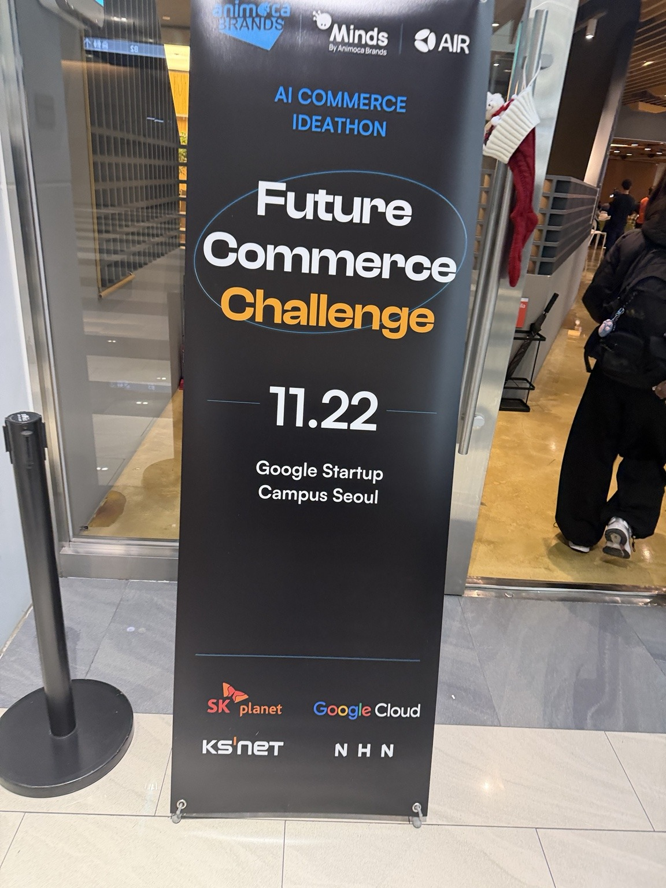

# Picky — AI Personal Shopping Agent

**SSKL | AI Commerce Ideathon · Future Commerce Challenge 2026**  
**November 22, 2026 | Google for Startups Campus Seoul**

> 당신을 가장 잘 아는 AI 쇼핑 에이전트  
> From product discovery and comparison to personalized purchasing decisions.

## Overview | 프로젝트 소개

**Picky** is a proposed AI-powered personal shopping agent designed to reduce the time spent searching across commerce platforms, comparing reviews, and evaluating total prices.

**Picky**는 쿠팡, 네이버, 무신사 등 여러 플랫폼을 반복 검색하며 리뷰와 가격을 비교해야 하는 불편을 해결하기 위해 제안한 **개인화 AI 쇼핑 에이전트**입니다.

**Status: ideathon concept and pitch.** This is proposal documentation, not a claim of a fully implemented or released product.

## Core Concepts

| Pillar | Proposed capability |
| --- | --- |
| **MEMORY** | Personal shopping memory for preferences, sizing and shopping history |
| **ANALYSIS** | Cross-platform review, product and price analysis |
| **RECOMMEND** | Personalized recommendations with clear rationale |
| **PROACTIVE** | Repurchase timing and price-drop suggestions |

**Conceptual journey:** Natural-language request → Personal preferences → Discovery → Comparison → Recommendations → Purchase decision

## Business Model (Pitch Proposal)

| Tier | Plan | Proposed monthly price |
| --- | --- | ---: |
| Free | Basic AI product search | ₩0 |
| Intelligence | Personal shopping memory & tailored recommendations | ₩9,900–14,900 |
| Agent | Proactive suggestions & purchase assistance | ₩19,900–29,900 |

Prices reflect the pitch proposal, not a live paid service.

## Go-to-Market & Roadmap

- Start with AI-native early adopters.
- Focus on one shopping category for initial validation.
- Expand based on recommendation quality and purchase outcomes.
- Pitch milestone: mobile MVP within 90 days (planned, not completed).
- Long-term concept: integrate with multiple AI ecosystems and commerce platforms.

## Event

**Future Commerce Challenge — AI Commerce Ideathon**  
**Date:** November 22, 2026  
**Venue:** Google for Startups Campus Seoul  
**Team:** SSKL (four people, as credited in the pitch deck)

The supplied event photograph shows the event banner and partner logos. Participation does not imply a prize, partnership, or endorsement.

## Pitch Materials

- [Original 12-slide pitch deck (PDF)](docs/Picky_Pitch_Deck_2026.pdf)
- [Pitch Deck Notes — 12-slide outline](docs/PITCH_DECK_NOTES.md)

## Event Photos

[Visitor badge (QR code redacted)](assets/event-badge-redacted.jpg)

## Repository Context

This project currently lives in the portfolio repository at `projects/picky-ai-shopping-agent/`, not in a separate GitHub repository.

## Disclaimer

Concept / ideathon materials only. No claim of executable product, live shopping integration, completed app launch, measured results, or external endorsement. No open-source license is granted by this README.
